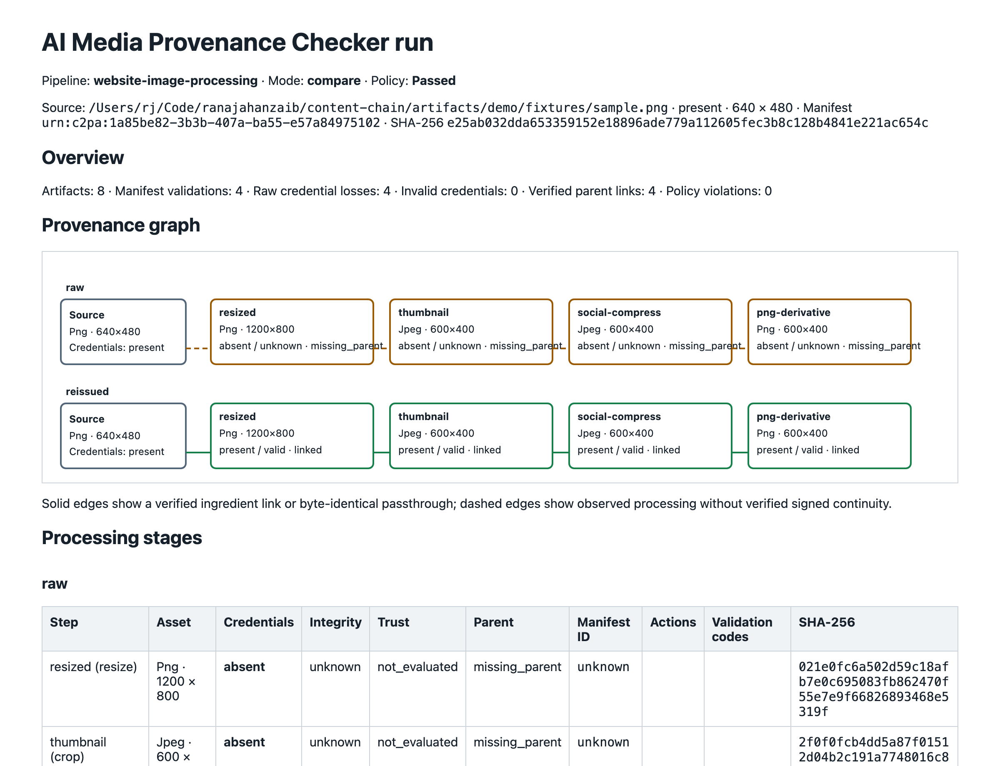
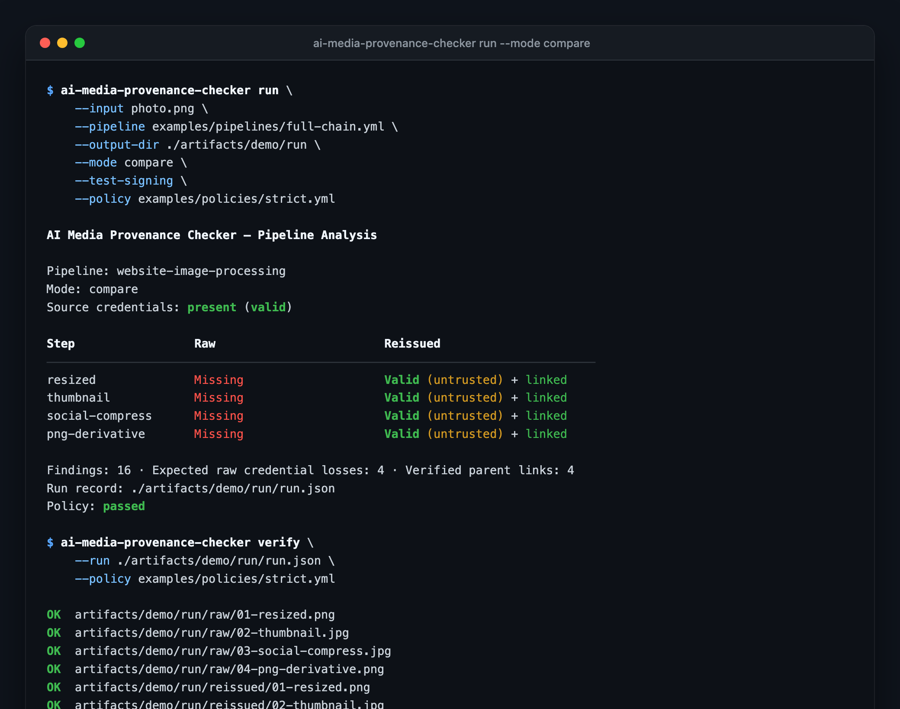
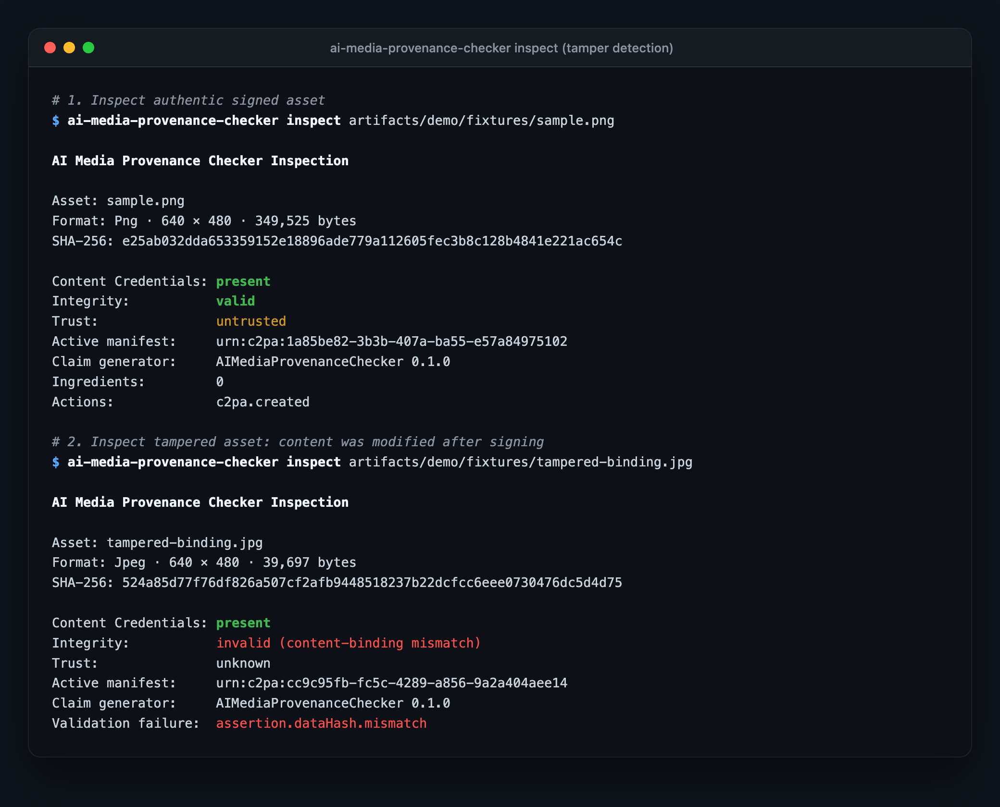
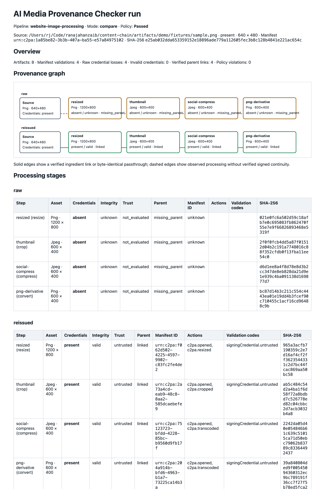
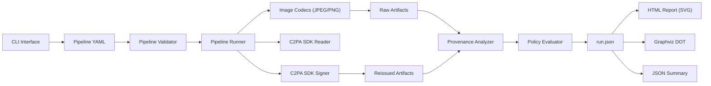

# AI Media Provenance Checker

**Verify whether C2PA Content Credentials survive image-processing pipelines.**

[](LICENSE)
[](Cargo.toml)
[](Cargo.toml)

AI Media Provenance Checker is a Rust CLI and CI verification tool for testing whether embedded C2PA Content Credentials survive declared image-processing workflows. It executes image transformations across an unsigned **raw branch** and a provenance-preserving **reissue branch**, then cryptographically validates each intermediate artifact, its parent manifest continuity, and content binding integrity using the official C2PA SDK.

---


_Figure 1: Dual-branch provenance analysis in the generated HTML report, comparing standard image encoder credential loss (dashed raw branch) against cryptographically linked manifest preservation (solid reissued branch)._

---

## The Problem It Solves

Image encoders and processing libraries (such as LibJPEG, image-rs, or standard CDN transforms) frequently strip embedded C2PA metadata (`JUMBFF` boxes) while outputting visually flawless images. In automated media workflows, this silently breaks the chain of custody.

AI Media Provenance Checker makes credential degradation reproducible and verifiable:

- **Reproduces encoder loss:** Demonstrates exactly where in a transformation chain credentials are discarded.
- **Validates reissue continuity:** Reissues claims with appropriate action assertions (`c2pa.resized`, `c2pa.cropped`, `c2pa.transcoded`) and verifies immediate-parent ingredient links (`parentOf`).
- **Detects post-signing tampering:** Distinguishes between missing manifests, untrusted signing authorities, and cryptographic content mismatches (`assertion.dataHash.mismatch`).
- **Enforces release policies in CI:** Blocks pull requests when media processing fails configured provenance requirements.

---

## Key Features

- **Dual-Branch Pipeline Execution:** Runs raw and reissue branches in lockstep to provide an objective baseline comparison.
- **C2PA Standard Compliance:** Integrates directly with the official Rust C2PA SDK (`v0.92.1`) to inspect manifests, certificates, and content bindings.
- **Cryptographic Tamper Detection:** Verifies image hashes against manifest assertions to detect pixel manipulation after signing.
- **Flexible Pipeline Definitions:** Declarative YAML pipelines supporting `resize`, `crop`, `compress`, `convert`, and `passthrough` operations for JPEG and PNG.
- **Strict Policy Engine:** Enforces customizable validation policies (`strict.yml`, `diagnostic.yml`) based on credential presence, integrity, and parent links.
- **Comprehensive Reporting:** Produces machine-readable `run.json` schemas, Graphviz `.dot` dependency graphs, and self-contained offline HTML reports with interactive SVG graphs.
- **Deterministic Test Fixtures:** Generates reproducible signed test assets and deliberately tampered samples without external dependencies.

---

## Demonstration Gallery

### Pipeline Execution & Policy Enforcement

Running `run --mode compare` processes each step, tracks credential states, and evaluates results against the configured security policy.


_Figure 2: Terminal output executing a 4-step image pipeline in compare mode, displaying raw losses vs. verified reissues and strict policy pass._

---

### Manifest Inspection & Tamper Detection

The `inspect` command evaluates asset metadata, distinguishes between valid signatures, and detects corrupted or tampered image content bindings.


_Figure 3: Inspecting a valid C2PA PNG asset versus an image with byte-level tampering, highlighting cryptographic data hash mismatch detection._

---

### Detailed Processing Stages & Hash Audit

The generated offline HTML report provides an end-to-end audit trail including SHA-256 hashes, action assertions, manifest IDs, and SDK validation codes.


_Figure 4: Detailed audit table from the generated HTML report showing per-stage cryptographic hashes, action assertions, and parent links._

---

## Quick Start

### Prerequisites

Requires stable Rust (edition 2024, Rust 1.96+) and native build dependencies required by OpenSSL and C2PA.

```sh
# Build the binary
cargo build --release

# Run unit, regression, and integration test suites
cargo test --all-targets

# Run the end-to-end verification demo
./scripts/demo.sh
```

The demo script automatically generates test fixtures, executes raw and reissued pipelines on sample PNG images, validates the strict policy, and writes reports to `artifacts/demo/report.html`.

---

## Installation

Install directly from local source:

```sh
cargo install --path .
```

Verify your installation and environment dependencies:

```sh
ai-media-provenance-checker doctor
```

---

## Common Workflows

### 1. Inspect an Image

Inspect any JPEG or PNG file for embedded C2PA manifests:

```sh
# Human-readable summary
ai-media-provenance-checker inspect photo.png

# Machine-readable JSON output
ai-media-provenance-checker inspect photo.png --json
```

### 2. Generate Test Fixtures

Create deterministic JPEG and PNG assets with in-memory test signatures and a deliberately tampered sample:

```sh
ai-media-provenance-checker fixtures generate --output-dir ./fixtures --test-signing
```

> [!NOTE]
> Ephemeral test signatures generated with `--test-signing` are intended exclusively for local testing and CI demonstration. Production deployments should configure a protected signing key and certificate via `--signing-config`.

### 3. Run a Pipeline

Execute a declared pipeline in `compare` mode:

```sh
ai-media-provenance-checker run \
  --input fixtures/sample.png \
  --pipeline examples/pipelines/full-chain.yml \
  --output-dir ./artifacts/run \
  --mode compare \
  --test-signing \
  --policy examples/policies/strict.yml
```

Available modes:

- `raw`: Runs standard image processing only, recording where credentials drop.
- `reissue`: Re-signs derived assets at each stage with parent ingredient links.
- `compare`: Executes both raw and reissued branches side-by-side.

### 4. Verify an Existing Run Record

Verify on-disk artifacts against their recorded hashes and validate against a policy:

```sh
ai-media-provenance-checker verify \
  --run ./artifacts/run/run.json \
  --policy examples/policies/strict.yml
```

### 5. Generate Multi-Format Reports

Export run results to HTML, DOT, or JSON:

```sh
# Self-contained offline HTML report with SVG provenance diagram
ai-media-provenance-checker report --run ./artifacts/run/run.json --format html --output ./artifacts/report.html

# Graphviz DOT graph
ai-media-provenance-checker report --run ./artifacts/run/run.json --format dot --output ./artifacts/graph.dot

# Pretty-printed JSON report
ai-media-provenance-checker report --run ./artifacts/run/run.json --format json --output ./artifacts/report.json
```

---

## Pipeline Configuration

Pipelines are declared in versioned YAML files (`examples/pipelines/full-chain.yml`):

```yaml
version: 1
name: website-image-processing
input:
  expected_format: png
steps:
  - id: resized
    type: resize
    width: 1200
    height: 800
    filter: lanczos3
    format: png
  - id: thumbnail
    type: crop
    x: 100
    y: 100
    width: 600
    height: 400
    format: jpeg
    quality: 82
  - id: social-compress
    type: compress
    quality: 74
  - id: png-derivative
    type: convert
    format: png
```

### Supported Operations

| Operation     | Required Parameters      | Optional Parameters                                                                             | Description                                        |
| :------------ | :----------------------- | :---------------------------------------------------------------------------------------------- | :------------------------------------------------- |
| `resize`      | `width`, `height`        | `sizing` (`exact`, `fit`), `filter` (`lanczos3`, `triangle`, `nearest`, `catmullrom`), `format` | Resizes image to specified dimensions.             |
| `crop`        | `width`, `height`        | `x`, `y`, `format`, `quality`                                                                   | Extracts a rectangular image region.               |
| `compress`    | None                     | `quality` (1–100)                                                                               | Compresses image using JPEG encoder.               |
| `convert`     | `format` (`jpeg`, `png`) | `background` (hex `#RRGGBB` for flattening alpha)                                               | Converts image format with transparency handling.  |
| `passthrough` | None                     | None                                                                                            | Byte-identical verification without modifications. |

---

## Policy Evaluation

Policies (`examples/policies/strict.yml`) define gatekeeping rules for CI pipelines:

```yaml
version: 1
requirements:
  require_output_credentials: true # Assets must contain readable C2PA manifests
  require_valid_integrity: true # Cryptographic content hashes must match
  require_parent_link: true # Must link to previous stage as parent ingredient
  require_transformation_action: true # Manifest must record corresponding action assertion
  require_trusted_signer: false # Set true when validating production PKI certificates
behavior:
  fail_on_unverifiable: true # Nonzero exit code if parent continuity is unverified
```

---

## Architecture



See [docs/ARCHITECTURE.md](docs/ARCHITECTURE.md) for details on parent ingredient validation and SDK isolation boundaries.

---

## CI/CD Integration

Integrate AI Media Provenance Checker into your CI workflow to ensure image pipeline pull requests do not strip provenance:

```yaml
- name: Verify Provenance Preservation
  run: |
    cargo run --release -- run \
      --input tests/fixtures/sample.png \
      --pipeline examples/pipelines/full-chain.yml \
      --output-dir ./artifacts/ci \
      --mode compare \
      --test-signing \
      --policy examples/policies/strict.yml

    cargo run --release -- verify \
      --run ./artifacts/ci/run.json \
      --policy examples/policies/strict.yml
```

### Exit Codes

- `0`: Successful execution and policy passed.
- `1`: Policy failure, cryptographic mismatch, or execution error.
- `2`: Invalid CLI syntax or illegal argument combination.

See [docs/CI_INTEGRATION.md](docs/CI_INTEGRATION.md) for full GitHub Actions workflows.

---

## Development & Testing

Ensure repository hygiene and test coverage:

```sh
# Format checking
cargo fmt --all -- --check

# Strict Clippy linter
cargo clippy --all-targets --all-features -- -D warnings

# Execute unit, integration, and regression suites
cargo test --all-targets
```

---

## Limitations

- **Formats:** Supports embedded C2PA manifests in JPEG and PNG containers. WebP, AVIF, HEIC, TIFF, and video containers (`MP4`, `MOV`) are not currently supported.
- **Storage:** Supports embedded metadata only (detached C2PA manifests and cloud-hosted sidecar manifests are not implemented).
- **Trust Lists:** Test signing generates ephemeral in-memory keys; public trust verification requires configuring an enterprise PKI trust store via `Settings`.

See [docs/LIMITATIONS.md](docs/LIMITATIONS.md) and [docs/SECURITY.md](docs/SECURITY.md) for more details.

---

## License & Custom Work

[](mailto:work@withrana.com) [](https://www.linkedin.com/in/workwithrana)
[](https://www.upwork.com/freelancers/~01bbcf6edb91a8df5f)
[](https://contra.com/ranajahanzaib/)

**License:** MIT, see [LICENSE](LICENSE). Free for personal and commercial use.

**Author:** Rana Jahanzaib

**Need this built for your stack?** Email me what you're working on: work@withrana.com
