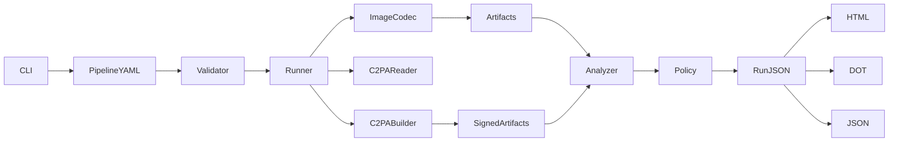

# AI Media Provenance Checker

**Preserve provenance through image-processing pipelines.**

AI Media Provenance Checker is a Rust CLI for checking whether embedded C2PA Content Credentials survive image processing. It runs the same declared JPEG/PNG pipeline as an unsigned raw branch and a provenance-aware reissue branch, then validates each output and its immediate-parent ingredient with the official C2PA SDK.

Image encoders can discard credentials while producing perfectly viewable images. AI Media Provenance Checker makes that difference reproducible and gives teams evidence they can use in CI. It is a reference processing path and diagnostic tool; it does not automatically repair arbitrary third-party pipelines.

## Quick start

Requires stable Rust and the native build tools required by the C2PA SDK.

```sh
cargo build --release
cargo test --all-targets
./scripts/demo.sh
```

To install the executable from a local checkout, run `cargo install --path .`.

The demo creates deterministic JPEG and PNG fixtures, signs them with a fresh in-memory test identity, runs raw and reissued branches on the PNG, checks the policy, and writes JSON, offline HTML, and DOT reports. Open `artifacts/demo/report.html`. The SDK-generated test identity is untrusted and must not be used for production claims.

To inspect an asset:

```sh
cargo run -- inspect photo.jpg
cargo run -- inspect photo.jpg --json
```

Run a pipeline with a real signing configuration:

```sh
cargo run -- run --input photo.png --pipeline examples/pipelines/full-chain.yml \
  --output-dir ./artifacts/run --mode compare \
  --signing-config ./local-signing.toml --policy examples/policies/strict.yml
cargo run -- verify --run ./artifacts/run/run.json --policy examples/policies/strict.yml
```

The example settings file is a template; configure the SDK with a protected signing key and certificate outside the repository. The explicit `--test-signing` flag generates a fresh, untrusted identity in memory and is intended only for local fixtures and demonstrations. See [signing](docs/SIGNING.md).

## What the results mean

AI Media Provenance Checker keeps credential presence, content-binding integrity, signer trust, and parent continuity separate. A valid signature does not prove that the signed assertions are true, and a valid test signature is not publicly trusted. An unsigned input says nothing about its origin. Raw branch losses are observations; policy violations are separate results.

JPEG and PNG are supported. Operations include resize, crop, JPEG compression, conversion, and byte-identical passthrough. Pipeline definitions are versioned YAML. Each stage writes a separate artifact. Outputs are created without overwriting existing paths.

```sh
cargo run -- run --input photo.png --pipeline examples/pipelines/full-chain.yml \
  --output-dir ./artifacts/run --mode compare --test-signing
cargo run -- report --run ./artifacts/run/run.json --format html --output ./artifacts/report.html
```

See [pipeline configuration](docs/PIPELINES.md), [report format](docs/REPORTING.md), [C2PA model](docs/C2PA_MODEL.md), [validation states](docs/VALIDATION.md), [security](docs/SECURITY.md), and [known limitations](docs/LIMITATIONS.md).

## Architecture



See [architecture documentation](docs/ARCHITECTURE.md) for details on the execution pipeline, parent-link validation, and SDK boundaries.

## CI integration

Use `run --mode compare` with a protected local signing configuration, then `verify --policy ...`. A failed policy returns a nonzero status. Preserve `run.json` and the generated reports as CI artifacts. Do not put signing keys in repository files or CI logs. The repository's CI checks formatting, Clippy, tests, build, and the signed workflow on Linux and macOS. See the [CI integration example](docs/CI_INTEGRATION.md) for an adaptable workflow.

Successful commands return `0`; policy, inspection, and execution failures return `1`; CLI syntax errors return `2`. The terminal summary uses plain text and emits no ANSI color sequences.

## Development

```sh
cargo fmt --all -- --check
cargo clippy --all-targets --all-features -- -D warnings
cargo test --all-targets
```

The official Rust SDK dependency is pinned to 0.91.7. AI Media Provenance Checker supports embedded JPEG/PNG credentials and does not implement detached manifests, WebP, video, certificate issuance, or automatic trust-list configuration. See [architecture](docs/ARCHITECTURE.md) and [contributing](CONTRIBUTING.md). MIT licensed.
