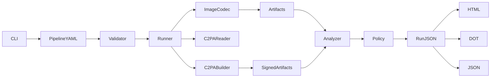

# Architecture

The v1 executable keeps the implementation in one binary module to keep the current surface small. Clap defines commands; the pipeline layer parses and validates YAML; the image layer decodes, transforms, hashes, and encodes bounded JPEG/PNG data; the C2PA boundary inspects with `Reader` and issues claims with `Builder` plus an explicit `Context`. Analysis compares SDK evidence against the recorded immediate input. Policy evaluation and JSON/HTML/DOT renderers consume the same serialized run model.

In compare mode each branch starts from the same source bytes. Every artifact records its input hash, operation parameters, output inspection, and parent-link assessment. `verify` reopens the source and outputs, checks hashes, re-evaluates parent relationships, and optionally applies a policy again. Filesystem outputs use exclusive creation via a temporary file and hard link. Inspection retains SDK validation JSON as evidence.

The pinned C2PA SDK is 0.91.7. AI Media Provenance Checker uses its context-based Reader/Builder APIs and standard `parentOf` ingredients and action assertions. It does not resolve arbitrary remote references or claim publicly trusted identity based on a successful local signature.
